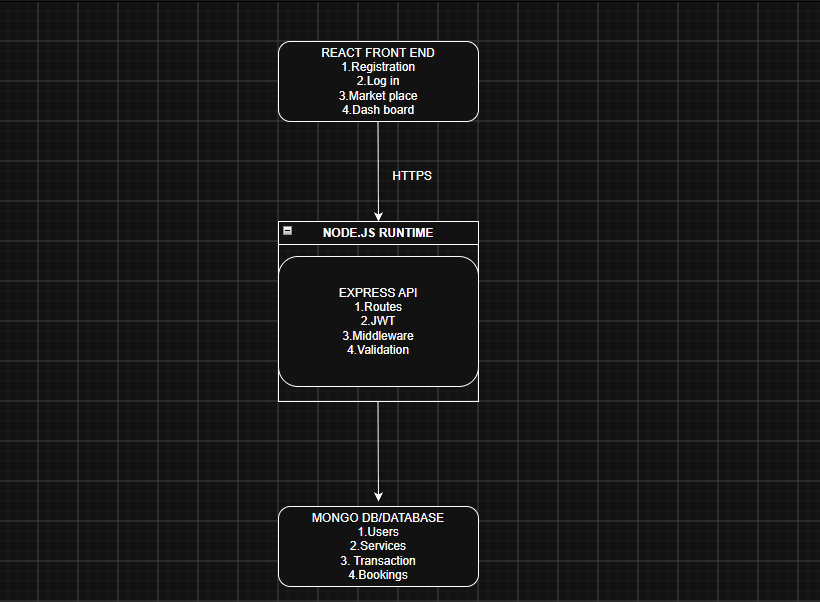
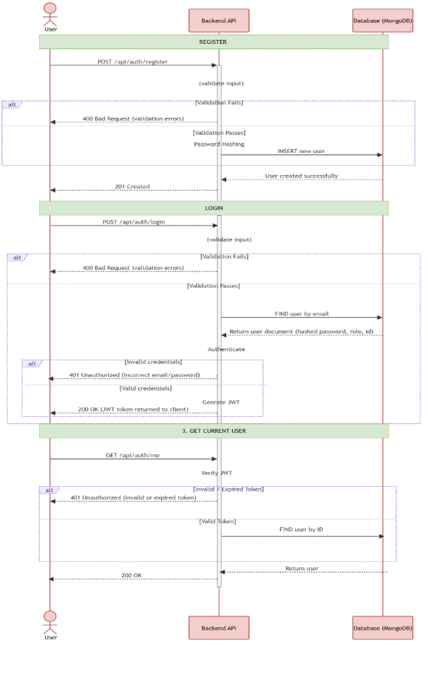

# insy7314-2026-insy7314-poe-classroom-tameezlambat

# Group Members

Cuan Oock - ST10439216  
Tameez Lambaat - ST10462078  
Atlegang GAMEDE – ST10445041  
Titus Ndaba - ST10448883  

# Youtube demo video

[https://youtu.be/hKSSmUVRzZM](https://youtu.be/hKSSmUVRzZM)

# Project Overview

This project is the beginning of the HustleHub system. HustleHub is meant to be a system serving as a centralised location for freelancers to market themselves and provide services. The system will allow freelancers to connect with clients and manage their finances in accordance with local tax laws.

For this part of the project, a backend API server and React frontend were developed. The backend API allows users to create accounts with their relevant roles in a secure and validated manner. The system also provides functionality for freelancers to create and manage services, while clients can browse available services and make bookings.

As this project handles sensitive user information, including user account information, transactions, and client/business information, security is of the utmost importance. Any leaking of this information could result in significant financial issues for users and legal trouble for HustleHub. This is why certain technology choices were made to allow for a secure backend API service.

# Technology Choices

## Password Encryption

This part of the project focuses specifically on user account creation and login in a secure way. For this password security is extremely important. For passwords stored in a database, it is never good practice to store it in plain text, and it is industry standard to store passwords only if they've been through an algorithm that allows for one way hashing. This means that the password is hashed in such a manner that it cannot be reversed back into the original password (Ciampa, 2022).

For this, bcrypt is used. This is an algorithm that allows for one way hashing and allows for multiple iterations of the algorithm to run over the password for added layers of security (GeeksforGeeks, 2024). This allows for protection against brute force attacks as the algorithm is designed to be computationally heavy, meaning hackers will waste a lot of time and computing power trying to brute force multiple password attempts.

It also protects against rainbow table attacks, whereby a hacker will have passwords in plain text with possible hashes, as bcrypt automatically adds a random salt to each password that is unique (GeeksforGeeks, 2024). This ultimately results in a secure environment for passwords wherein even if the hashed password is obtained, user data will remain uncompromised.

## JWT

This backend server also makes use of JWT tokens. This allows for secure authentication when users interact with protected resources. For this system specifically, once a user role is authorised, the user will be assigned a JWT token, which is attached to the header of authenticated HTTPS requests through the application frontend (GeeksforGeeks, 2019).

This means that, without the server needing to store excess session data, the end user can have their authentication information and role used to access protected functionality while interacting with the system.

## SSL certificate

Finally, this backend server is configured to work with HTTPS using an SSL certificate. This means that the connection is encrypted between the server and a connecting client browser (Serpanos and Wolf, 2011).

It works by the server having an SSL certificate with a public key. A client browser can use this to establish an encrypted connection, meaning that data transmitted between the client and server is protected from being read by unauthorised parties (White and West, 2023).

# How to Run HustleHub+

Follow these steps to set up and run the HustleHub+ application locally.

## 1. Clone the Repository

Clone the repository and open the project folder in a terminal.

## 2. Install Backend Dependencies

From the project root, run:

```powershell
npm install
```

This installs the required Node.js dependencies listed in `package.json`.

## 3. Configure Environment Variables

Create a file named `.env` in the root directory of the project.

The environment file should contain the required configuration, including the MongoDB connection string and HTTPS settings.

Example:

```env
MONGO_URI=your_mongodb_connection_string
JWT_SECRET=your-development-secret
USE_HTTPS=true
SSL_KEY_PATH=./server.key
SSL_CERT_PATH=./server.crt
```

Replace the placeholder values with the appropriate project configuration.

The `.env` file contains environment-specific configuration and should be kept secure.

## 4. HTTPS Certificate

HustleHub+ runs locally over HTTPS using an SSL certificate.

The project uses the following certificate files in the project root:

```text
server.crt
server.key
```

If the certificates have not been provided with the project, they can be generated locally using OpenSSL.

Check that OpenSSL is installed:

```powershell
openssl version
```

Generate a local certificate and private key:

```powershell
openssl req -x509 -newkey rsa:2048 -keyout server.key -out server.crt -sha256 -days 365 -nodes
```

When prompted for the certificate information, use:

```text
Common Name (e.g. server FQDN or YOUR name) []: localhost
```

The remaining fields can be left blank or completed as required.

This creates:

```text
server.crt
server.key
```

## 5. Start the Backend

Open a terminal in the project root directory and run:

```powershell
npm start
```

The backend API should start on:

[https://localhost:5000](https://localhost:5000)

A successful startup should display messages similar to:

```text
MongoDB connected successfully
HustleHub+ API running on https://localhost:5000
```

Keep this terminal running.

## 6. Start the React Frontend

Open a **second terminal** while leaving the backend terminal running.

Navigate into the frontend directory:

```powershell
cd frontend
```

Then start the React development server:

```powershell
npm run dev
```

The frontend should be available at:

[http://localhost:5173](http://localhost:5173)

Open this address in a browser to use the HustleHub+ application.

## Running Both Parts

The application requires both the backend and frontend to be running simultaneously.

**Terminal 1 — Backend:**

```powershell
npm start
```

**Terminal 2 — Frontend:**

```powershell
cd frontend
npm run dev
```

The frontend communicates with the backend API through:

[https://localhost:5000](https://localhost:5000)

## 7. Main Application Features

### Client

Clients can:

- Register and log in as a client
- Browse available freelance services
- View individual service details
- Book services
- Receive a simulated booking and payment confirmation
- View their bookings
- View previously booked services

### Freelancer

Freelancers can:

- Register and log in as a freelancer
- Create services
- View their own services
- Edit existing services
- Delete their own services
- View individual service details
- View bookings made for their services
- View total earnings
- View their freelancer dashboard

## 8. Test the API

The API can be tested using Postman.

The main authentication endpoints are:

```text
POST https://localhost:5000/api/auth/register
POST https://localhost:5000/api/auth/login
GET  https://localhost:5000/api/auth/me
```

The gig, booking and transaction endpoints are available through:

```text
/api/gigs
/api/bookings
/api/transactions
```

Protected endpoints require a valid JWT Bearer token.

## 9. Seeded Admin Account

An administrator account is available for testing. Public registration does not allow users to create an administrator account.

The following credentials can be used for testing:

| Role | Email | Password |
|---|---|---|
| Admin | `admin@hustlehub.com` | `AdminPassword123!` |

This account is intended for local development and testing.

## Important Notes

The following files contain environment-specific configuration or security credentials:

```text
.env
server.key
server.crt
```

These files should be handled securely and should not be exposed outside the intended project members and assessment staff.

The MongoDB connection string should be kept secure and only provided to authorised members of the project and the relevant assessment staff.

# Diagrams

### Architecture



### Flow Diagram



## Screenshots of Postman Testing

### Registration

#### Register - Valid Client


#### Register - Valid Freelancer


#### Register - Duplicate User


#### Register - Missing Fields


#### Register - Invalid Email


#### Register - Weak Password


#### Register - Admin Attempt


### Login

#### Login - Client - Valid


#### Login - Freelancer - Valid


#### Login - Admin - Valid


#### Login - Wrong Password


#### Login - Invalid Email


#### Login - Missing Fields


### JWT

#### JWT - No Token


#### JWT - Valid Token


#### JWT - Invalid Token


### HTTPS

#### HTTPS - Health Check


### Error Handling

#### Invalid JSON


#### Missing Content


#### Protected Route - Invalid Token


# Seperation of Work

| Name | Responsibilities |
|---|---|
| Tameez Lambaat | Endpoint setup, Password encryption, Error handling |
| Atlegang Gamede | JWT token setup, Error debugging |
| Cuan Oock | Documentation and Diagrams |
| Titus Ndaba | User Input Validation, SSL certification |

# References

The IIE, 2025. Information Systems 3D, INSY7314 MODULE MANUAL, The Independent Institute of Education: Unpublished.

GeeksforGeeks (2024). NPM bcrypt. [online] GeeksforGeeks. Available at: [https://www.geeksforgeeks.org/node-js/npm-bcrypt/](https://www.geeksforgeeks.org/node-js/npm-bcrypt/) [Accessed 5 Sept. 2026].

GeeksforGeeks (2019). JSON Web Token (JWT). [online] GeeksforGeeks. Available at: [https://www.geeksforgeeks.org/web-tech/json-web-token-jwt/](https://www.geeksforgeeks.org/web-tech/json-web-token-jwt/) [Accessed 5 Sept. 2026].

Ciampa, M. Security+ Guide to Network Security Fundamentals. 2022. 7th ed. Cengage: Boston.

Serpanos, D. & Wolf, T. Architecture of Network Systems. 2011. Burlington: Elsevier.

White, C.M. & West, J. Data Communications & Computer Networks: A Business User’s Approach. 9th Edition. 2023. Cengage Learning: Boston.