# insy7314-2026-insy7314-poe-classroom-tameezlambat

# Group Members

Cuan Oock - ST10439216  
Tameez Lambaat - ST10462078  
Atlegang GAMEDE – ST10445041  
Titus Ndaba - ST10448883  

# Updated Youtube demo video

[https://youtu.be/iELxDHfDBEo?si=W6eOj3fZwreM4FTM](https://youtu.be/iELxDHfDBEo?si=W6eOj3fZwreM4FTM)

# Project Overview

HustleHub+ is a web application designed to connect freelancers with clients through a centralised platform for advertising and discovering freelance services.

The application consists of a React frontend and a Node.js/Express backend API, with MongoDB used for data storage. The system supports three user roles: clients, freelancers, and administrators. Clients can browse available services and access booking functionality, freelancers can create and manage their gigs, and administrators have a dedicated role for administrative functionality within the system.

Users can register as clients or freelancers and authenticate securely to access functionality according to their assigned roles. Administrator accounts cannot be created through public registration, helping prevent unauthorised users from granting themselves administrative privileges.

Security is a key consideration in the application. HustleHub+ uses bcrypt for password hashing, JSON Web Tokens (JWT) for authentication, role-based access control, input validation, protected API routes, and HTTPS support. Gig management also incorporates ownership checks intended to prevent freelancers from modifying or deleting services belonging to other users.

## System Architecture

HustleHub+ uses a client-server architecture consisting of a React frontend, a Node.js/Express backend API and a MongoDB database.

- **Frontend (React):** Provides the user interface through which clients browse and book services, freelancers manage their gigs, and administrators access administrative functionality.
- **Backend (Node.js and Express):** Receives requests from the frontend, routes them to the appropriate endpoints, applies authentication, authorisation and validation checks, and coordinates application logic.
- **Middleware:** Processes requests before they reach the relevant controller. Depending on the endpoint, this includes JWT authentication, role-based access control, input validation, rate limiting and security-related checks.
- **Controllers:** Handle application operations, including account management, gig management and bookings, and communicate with the database through the application's data-access logic.
- **Database (MongoDB):** Stores application data, including user accounts, gigs and booking-related records.
- **HTTP responses:** The backend returns the result of each request to the frontend, which updates the interface or displays an appropriate error message.

This separation of responsibilities helps organise the application, makes the backend API reusable independently of the user interface, and allows request validation and security checks to be applied centrally.


# Technology Choices

Authentication and Authorisation

HustleHub+ uses JWT-based authentication to identify authenticated users when they access protected API endpoints. Tokens contain the user's identifier and role and are signed using a secret configured through environment variables.

Role-based access control restricts functionality according to the user's assigned role. Public registration supports client and freelancer accounts, while administrator accounts cannot be created through the public registration endpoint.

Password and Input Validation

Passwords are hashed using bcrypt before being stored in MongoDB. Registration and login requests are processed through validation middleware to check submitted data before the corresponding controller executes. Gig creation and update requests also use validation rules for fields such as title, description, category and price.

Validation failures return an HTTP 400 response with details of the rejected fields. Duplicate email addresses are rejected during registration, and login failures return a generic invalid-credentials message.

Gig Ownership Protection

Gig management endpoints use authentication and authorisation middleware. Ownership checks are intended to ensure that a freelancer can modify or delete only their own gigs. Requests involving gigs that the authenticated freelancer does not own should be rejected rather than allowing unauthorised changes.

API Protection and HTTPS

The backend includes security middleware and rate limiting to help reduce common API risks, including excessive authentication attempts. HTTPS can be enabled through environment configuration so that communication between the browser and backend is encrypted during local development.

Environment variables, database credentials, JWT secrets and private SSL keys must be kept out of public repositories. The actual configuration should be supplied through a local .env file or the deployment environment.

## Password Encryption

This part of the project focuses specifically on user account creation and login in a secure way. For this password security is extremely important. For passwords stored in a database, it is never good practice to store it in plain text, and it is industry standard to store passwords only if they've been through an algorithm that allows for one way hashing. This means that the password is hashed in such a manner that it cannot be reversed back into the original password (Ciampa, 2022).

For this, bcrypt is used. This is an algorithm that allows for one way hashing and allows for multiple iterations of the algorithm to run over the password for added layers of security (GeeksforGeeks, 2024). This allows for protection against brute force attacks as the algorithm is designed to be computationally heavy, meaning hackers will waste a lot of time and computing power trying to brute force multiple password attempts.

It also protects against rainbow table attacks, whereby a hacker will have passwords in plain text with possible hashes, as bcrypt automatically adds a random salt to each password that is unique (GeeksforGeeks, 2024). Although bcrypt helps protect passwords if stored hashes are exposed, it cannot guarantee that other user data will remain secure. Additional security measures, including access control, input validation and encrypted communication, are still necessary.

## JWT

This backend server also makes use of JWT tokens. This allows for secure authentication when users interact with protected resources. For this system specifically, once a user role is authorised, the user will be assigned a JWT token, which is attached to the header of authenticated HTTPS requests through the application frontend (GeeksforGeeks, 2019).

This means that, without the server needing to store excess session data, the end user can have their authentication information and role used to access protected functionality while interacting with the system.

### Why JWT Rather Than Server-Side Sessions?

HustleHub+ uses JSON Web Tokens (JWTs) to authenticate requests to protected API endpoints. After a successful login, the backend issues a signed token containing the user's identifier and role. The frontend sends the token with subsequent protected requests, allowing the backend to verify the token and identify the user.

An alternative is traditional server-side session authentication. With this approach, the server creates a session and stores session information, while the client sends a session identifier with subsequent requests. The server then uses that identifier to retrieve the corresponding session.

JWT was selected because it allows the API to verify signed authentication claims without looking up a server-side session record for every request. This can simplify authentication for a frontend that communicates with a separate backend API and can reduce dependence on centrally stored session state.

However, JWT is not universally more secure or always faster than session-based authentication. Server-side sessions make central session invalidation straightforward, whereas a JWT may remain valid until it expires unless additional revocation mechanisms are implemented. JWTs also require careful handling because anyone who obtains a usable token may be able to impersonate its holder until the token becomes invalid.

For this reason, JWT authentication must be combined with signature verification, suitable token expiry, secure token handling, HTTPS and server-side authorisation checks. The token identifies the authenticated user; the backend must still verify that the user has permission to perform the requested operation.


## SSL certificate

Finally, this backend server is configured to work with HTTPS using an SSL certificate. This means that the connection is encrypted between the server and a connecting client browser (Serpanos and Wolf, 2011).

It works by the server having an SSL certificate with a public key. A client browser can use this to establish an encrypted connection, meaning that data transmitted between the client and server is protected from being read by unauthorised parties (White and West, 2023).

# How to Run HustleHub+

Follow these steps to set up and run the HustleHub+ application locally.

## 1. Clone the Repository

Clone the repository and open the project folder in a terminal.

## 2. Install Backend Dependencies

From the project root, run:

```powershell
npm install
```

This installs the required Node.js dependencies listed in `package.json`.

## 3. Configure Environment Variables

Create a file named `.env` in the root directory of the project.

The environment file should contain the required configuration, including the MongoDB connection string and HTTPS settings, aswell as the admin details to be seeded on running the app.

Example:

```env
MONGO_URI=your_mongodb_connection_string
JWT_SECRET=your-development-secret
USE_HTTPS=true
SSL_KEY_PATH=./server.key
SSL_CERT_PATH=./server.crt
ADMIN_NAME=HustleHub Admin
ADMIN_EMAIL=admin@hustlehub.com
ADMIN_PASSWORD=AdminLogin12345_!
```

Replace the placeholder values with the appropriate project configuration. 

The `.env` file contains environment-specific configuration and should be kept secure.

## 4. HTTPS Certificate

HustleHub+ runs locally over HTTPS using an SSL certificate.

The project uses the following certificate files in the project root:

```text
server.crt
server.key
```

If the certificates have not been provided with the project, they can be generated locally using OpenSSL.

Check that OpenSSL is installed:

```powershell
openssl version
```

Generate a local certificate and private key:

```powershell
openssl req -x509 -newkey rsa:2048 -keyout server.key -out server.crt -sha256 -days 365 -nodes
```

When prompted for the certificate information, use:

```text
Common Name (e.g. server FQDN or YOUR name) []: localhost
```

The remaining fields can be left blank or completed as required.

This creates:

```text
server.crt
server.key
```

## 5. Start the Backend

Open a terminal in the project root directory and run:

```powershell
npm start
```

The backend API should start on:

[https://localhost:5000](https://localhost:5000)

A successful startup should display messages similar to:

```text
MongoDB connected successfully
HustleHub+ API running on https://localhost:5000
```

Keep this terminal running.

## 6. Start the React Frontend

Open a **second terminal** while leaving the backend terminal running.

Navigate into the frontend directory:

```powershell
cd frontend
```

Then start the React development server:

```powershell
npm run dev
```

The frontend should be available at:

[http://localhost:5173](http://localhost:5173)

Open this address in a browser to use the HustleHub+ application.

## Running Both Parts

The application requires both the backend and frontend to be running simultaneously.

**Terminal 1 — Backend:**

```powershell
npm start
```

**Terminal 2 — Frontend:**

```powershell
cd frontend
npm run dev
```

The frontend communicates with the backend API through:

[https://localhost:5000](https://localhost:5000)

## 7. Main Application Features

### Client

Clients can:

- Register and log in as a client
- Browse available freelance services
- View individual service details
- Book services
- Receive simulated booking and payment confirmations
- View their bookings
- View previously booked services

### Freelancer

Freelancers can:

- Register and log in as a freelancer
- Create freelance gigs and advertise their services
- View their own gigs
- Edit existing gigs
- Delete their own gigs
- View individual gig details
- View bookings made for their services
- View total earnings
- Access their freelancer dashboard

### Administrator

Administrators can:

- Log in using an administrator account
- View existing accounts
- Use the administrator account provided for local development and testing

Administrator accounts cannot be created through public registration.

### Security and Validation

The application includes the following security features:

- Password hashing using bcrypt
- JWT-based authentication for protected endpoints
- Role-based access control for clients, freelancers and administrators
- Input validation for registration, login and gig management
- Error handling for invalid requests and authentication failures
- Ownership checks intended to prevent freelancers from modifying or deleting gigs belonging to other freelancers
- HTTPS support for encrypted communication between the frontend and backend

## 8. Test the API

The API can be tested using Postman.

The main authentication endpoints are:

```text
POST https://localhost:5000/api/auth/register
POST https://localhost:5000/api/auth/login
GET  https://localhost:5000/api/auth/me
```

The gig, booking and transaction endpoints are available through:

```text
/api/gigs
/api/bookings
/api/transactions
```

Protected endpoints require a valid JWT Bearer token.

## 9. Seeded Admin Account

An administrator account can be seeded for testing. Public registration does not allow users to create an administrator account.

The following credentials can be used for testing:

| Role | Email | Password |
|---|---|---|
| Admin | `admin@hustlehub.com` | `AdminLogin12345_!` |

This account is intended for local development and testing.

## Important Notes

The following files contain environment-specific configuration or security credentials:

```text
.env
server.key
server.crt
```

These files should be handled securely and should not be exposed outside the intended project members and assessment staff.

The MongoDB connection string should be kept secure and only provided to authorised members of the project and the relevant assessment staff.

# Diagrams

### Architecture


### Flow Diagram


### Authentication Data Workflows

#### 1. Register

- The user submits the registration form through the React frontend.
- The frontend sends a `POST` request to `/api/auth/register` containing the user's registration details.
- The Express backend receives the request and applies the registration validation middleware.
- If validation fails, the API returns a `400 Bad Request` response containing validation errors.
- If validation succeeds, the registration controller checks whether the email address is already registered.
- If the email address is available, the controller hashes the password using bcrypt.
- The new user's details, including the hashed password and assigned role, are saved to MongoDB.
- Once the user is created successfully, the API returns a `201 Created` response to the frontend.
- The frontend processes the response and displays the appropriate registration result.

#### 2. Login

- The user submits their email address and password through the React frontend.
- The frontend sends a `POST` request to `/api/auth/login` containing the login credentials.
- The Express backend applies the login validation middleware.
- If validation fails, the API returns a `400 Bad Request` response.
- If validation succeeds, the login controller queries MongoDB to find the user associated with the submitted email address.
- MongoDB returns the matching user document, including the stored password hash, user ID and role.
- The controller compares the submitted password with the stored hash using bcrypt.
- If the user does not exist or the credentials are incorrect, the API returns a generic authentication failure response, typically `401 Unauthorized`.
- If authentication succeeds, the backend generates a signed JSON Web Token (JWT) containing the user's identity and role.
- The API returns a `200 OK` response containing the token to the frontend.
- The frontend uses the token when making subsequent requests to protected API endpoints.

#### 3. Get Current User

- The frontend sends a `GET` request to `/api/auth/me`, including the JWT in the `Authorization` header using the Bearer token format.
- The Express backend passes the request through its authentication middleware.
- The middleware verifies the token's signature and validity and extracts the authenticated user's identity.
- If the token is missing, invalid or expired, the API returns a `401 Unauthorized` response.
- If the token is valid, the endpoint retrieves the corresponding user record from MongoDB, if required by the implementation.
- If the user record is found, the API returns a `200 OK` response containing the current user's permitted information.
- The frontend processes the response and updates the interface to reflect the authenticated user's state.

#### 4. Create and Manage a Gig

- A freelancer uses the React frontend to submit a new gig or update an existing gig.
- The frontend sends the relevant request to the Express API, including the required gig details and a JWT for protected operations.
- The Express backend matches the request to the appropriate gig endpoint.
- Authentication middleware verifies the JWT and identifies the requesting user.
- Authorisation middleware and validation rules check the user's permissions and the submitted gig data.
- For an update or deletion, the backend must verify that the gig belongs to the authenticated freelancer.
- If authentication, authorisation, validation or ownership checks fail, the API returns an appropriate error response without performing the unauthorised operation.
- If the checks pass, the controller processes the request and the application's database logic creates or updates the relevant MongoDB record.
- The backend returns the operation's result to the frontend.
- The frontend displays the result and refreshes the relevant gig information.

#### 5. Create and Retrieve a Booking

- A client browses available gigs through the React frontend and selects a service to book.
- The frontend sends a booking request to the Express API containing the relevant gig identifier and any required booking information.
- The backend matches the request to the booking endpoint and verifies authentication where required.
- The backend validates the submitted information and checks that the referenced gig exists.
- If the request is invalid or the gig cannot be found, the API returns an appropriate error response.
- If the checks pass, the booking controller processes the request and saves the booking to MongoDB.
- The backend returns a response indicating whether the booking was created successfully.
- The frontend displays the booking result and updates the user's booking information.
- When a client or freelancer retrieves bookings, the backend must apply the appropriate access controls so users cannot access booking information they are not authorised to view.


## Postman API Testing

The HustleHub+ REST API was tested using Postman to verify endpoint functionality, input validation, authentication, role-based access control, sanitisation, rate limiting, and security headers.

### 1. Health and Gig Retrieval

| Test | Purpose |
|---|---|
| `API` | Checks whether the API responds to a request. |
| `GIGS` | Retrieves the list of gigs. |
| `Gig Not Found` | Tests the response when a gig ID does not exist. |
| `GIG bad ID` | Tests handling of an invalid gig ID format. |

### 2. User Registration

| Test | Purpose |
|---|---|
| `Register Client Success` | Tests successful client registration. |
| `Register Freelancer Success` | Tests successful freelancer registration. |
| `Freelancer Two Register` | Tests registration of a second freelancer account. |
| `Invalid Email` | Tests registration with an invalid email address. |
| `Register No Fields` | Tests registration when required fields are missing. |
| `Public Admin Reg` | Checks whether public registration prevents users from registering as administrators. |
| `Weak Password` | Tests password strength validation. |
| `Short Name` | Tests name length validation. |

### 3. Login and Authentication

| Test | Purpose |
|---|---|
| `Clietn Login` | Tests successful client login. |
| `Freelancer 1 Login` | Tests successful login for the first freelancer. |
| `Freelancer 2 Login` | Tests successful login for the second freelancer. |
| `Incorrect Password` | Tests login with an incorrect password. |
| `Invalid Email Login` | Tests login with an invalid email address. |
| `Access Profile No Token` | Checks whether profile access is denied without an authentication token. |
| `Valid Token Access` | Tests profile access using a valid authentication token. |
| `Admin Login` | Tests administrator login. |

### 4. Gig Management and Booking Validation

| Test | Purpose |
|---|---|
| `Ok Gig update` | Tests updating an existing gig. |
| `Gig creation` | Tests creating a gig. |
| `Unauthenticated Gig Creation` | Checks whether gig creation is denied without authentication. |
| `Create Gig Negative Price` | Tests rejection of a gig with a negative price. |
| `Empty Gig Title` | Tests validation of an empty gig title. |
| `Empty Gig description` | Tests validation of an empty gig description. |
| `Booking WithoutGigId` | Tests booking creation without a gig ID. |
| `Booking With Bad GigId` | Tests booking creation with an invalid gig ID. |
| `Valid Booking` | Tests creation of a booking with valid input. |

### 5. Role-Based Access Control (RBAC)

| Test | Purpose |
|---|---|
| `Unauthenticated Gig Create` | Checks whether gig creation is blocked for unauthenticated users. |
| `Denied Client Gig Creation` | Checks whether clients are prevented from creating gigs. |
| `Freelance Gig Create` | Tests gig creation by a freelancer. |
| `Unauthenticated Booking` | Checks whether booking access is denied without authentication. |
| `Freelancer Booking Forbidden Create` | Checks whether freelancers are prevented from creating bookings. |
| `Client Forbidden Income CHeck` | Checks whether clients are denied access to freelancer income information. |
| `Freelancer Gets Income` | Tests whether a freelancer can access their income information. |
| `Unauthenticated Income Check` | Checks whether income information is protected from unauthenticated users. |
| `Client Access Booking` | Tests client access to bookings. |
| `Freelancer Access Booking` | Tests freelancer access to bookings. |
| `Unauthenticated Booking` | Checks booking access without authentication. |
| `Admin View Bookings` | Tests administrator access to booking information. |

### 6. Input Sanitisation

| Test | Purpose |
|---|---|
| `HTML in description` | Tests how HTML content in a gig description is handled. |
| `Remove MongoDB operator` | Tests handling of MongoDB operator injection attempts. |
| `Mongo DB key` | Tests handling of input containing MongoDB-related keys. |

### 7. Rate Limiting

| Test | Purpose |
|---|---|
| `Repeat Failed Login` | Tests repeated failed login attempts against the authentication rate limiter. |
| `Booking` | Exercises the booking endpoint while checking its configured rate-limiting behaviour. |

### 8. Security Headers and CORS

| Test | Purpose |
|---|---|
| `Check Security Keys` | Checks the security headers returned by the API. |
| `Allowed Origin` | Tests a request from an allowed origin. |
| `Untrusted Origin` | Tests handling of a request from an untrusted origin. |

### Test Execution

The Postman collection can be executed using Postman or Newman, the command-line runner for Postman collections. Newman HTML reports can be used to review request results and identify failed tests.

The collection covers successful requests, invalid input, authentication failures, access-control restrictions, sanitisation, rate limiting, and security configuration.

The HTML test report is available in the [`Testing`](./Testing/) folder for reference.

### Application Screenshots

#### Admin Dashboard

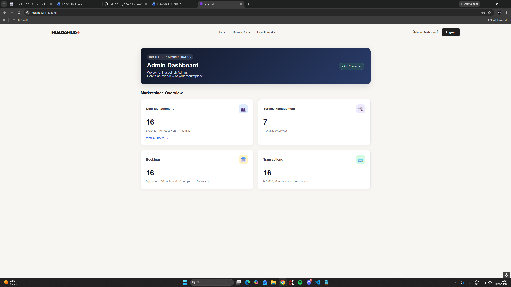

#### Admin View Users

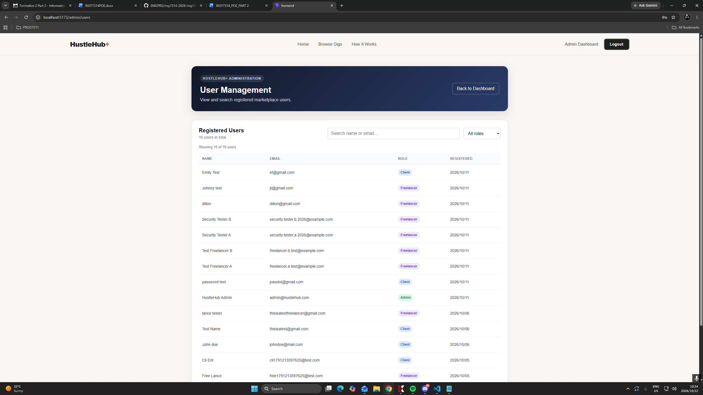

#### Book A Service

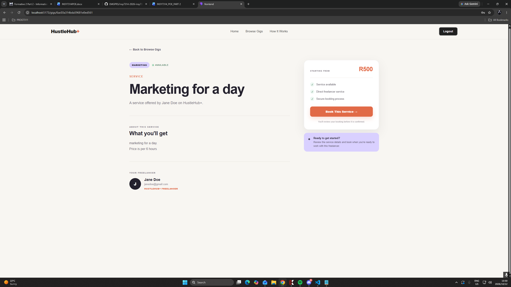

#### Booking Confirmation

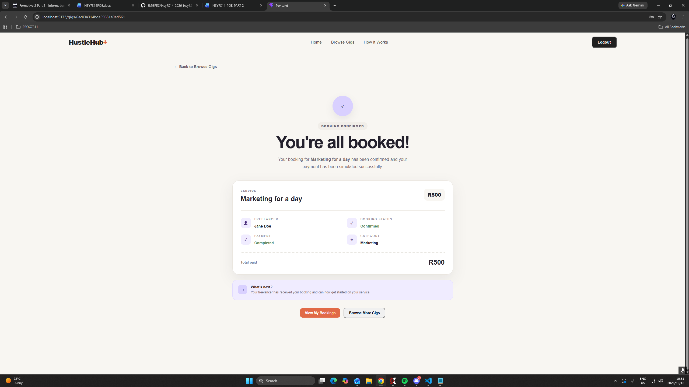

#### Browse Gigs

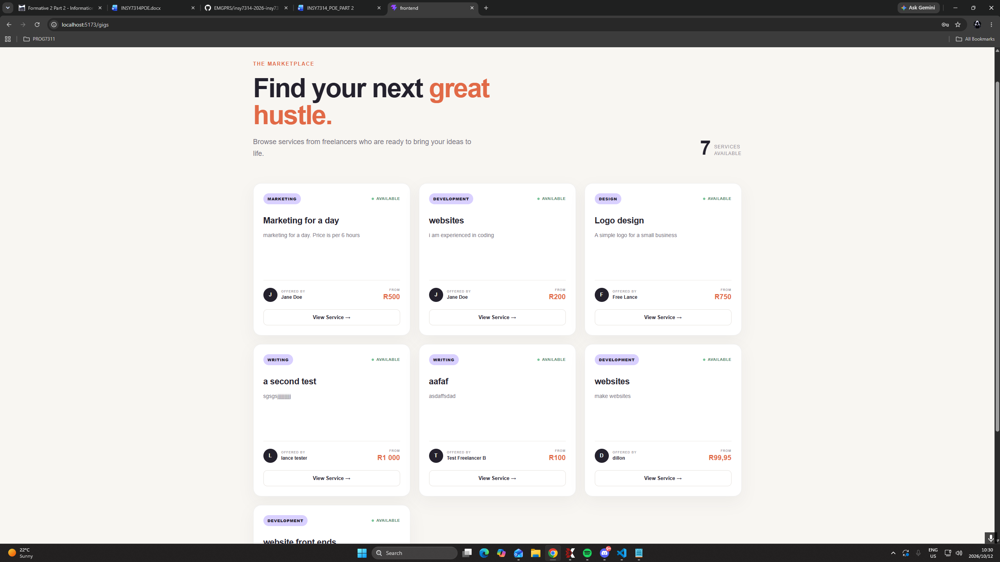

#### Client Home

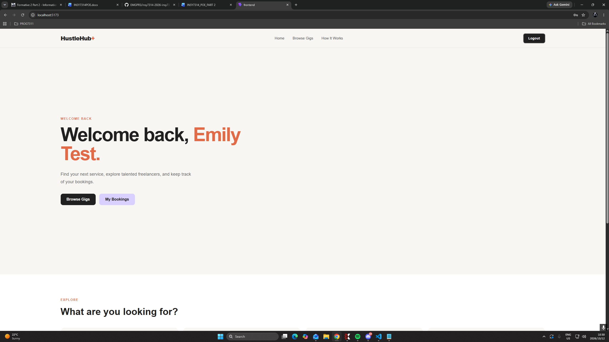

#### Create A Gig

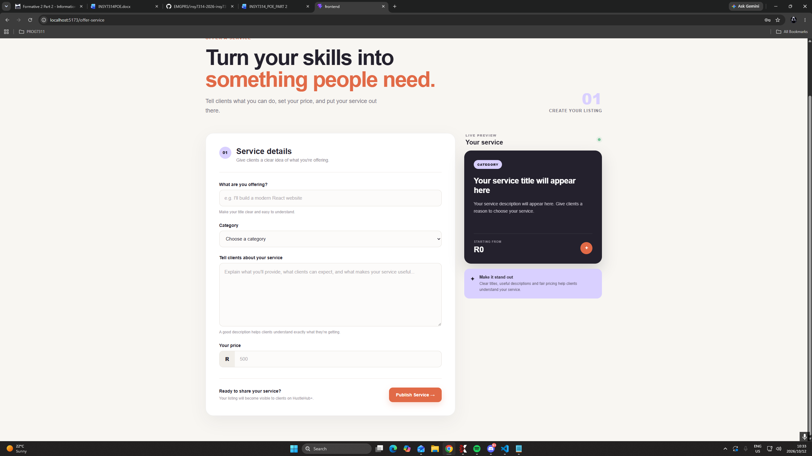

#### Freelancer Dashboard

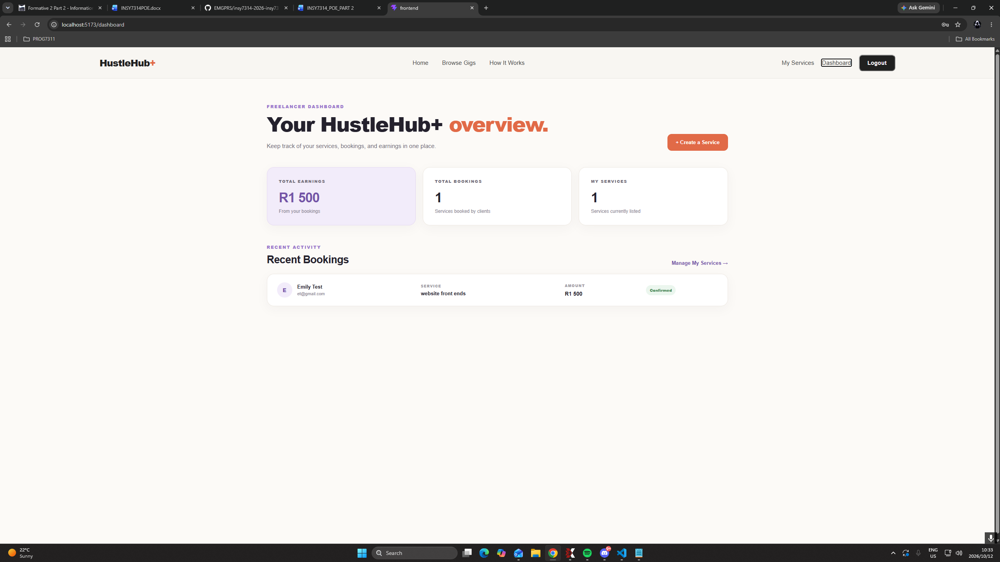

#### Freelancer Gigs

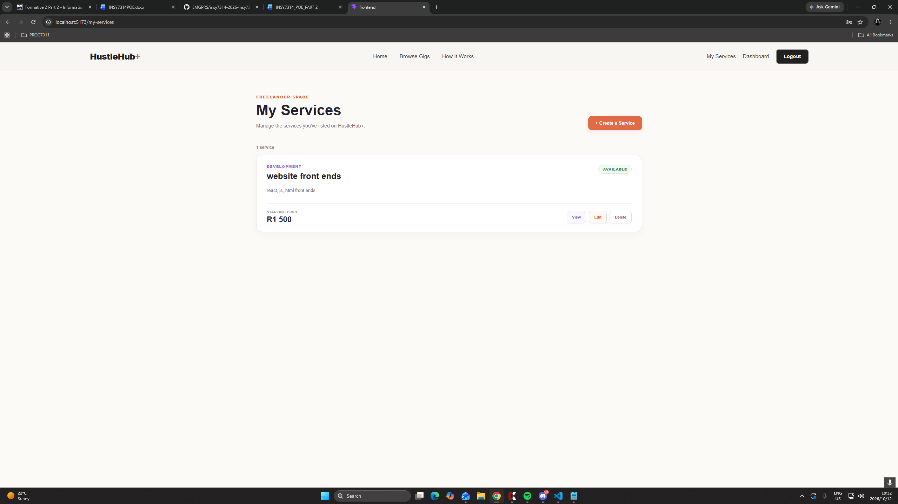

#### Freelancer Home

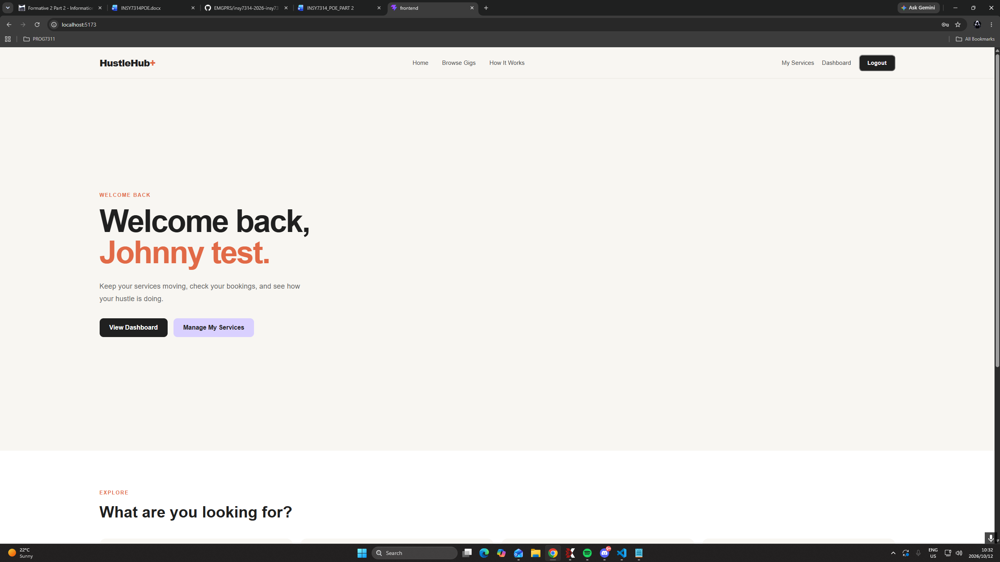

#### Home Page

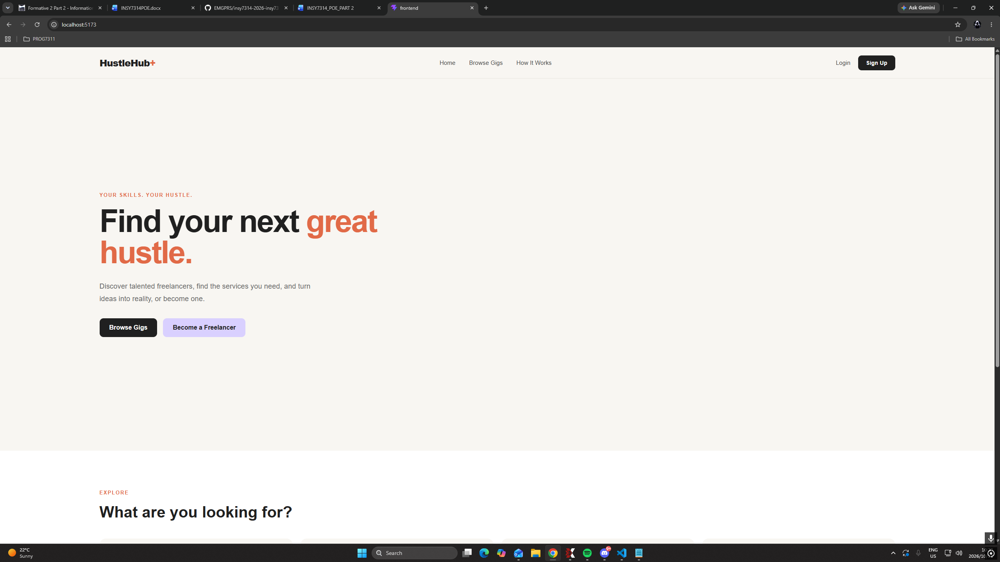

#### Login Screen

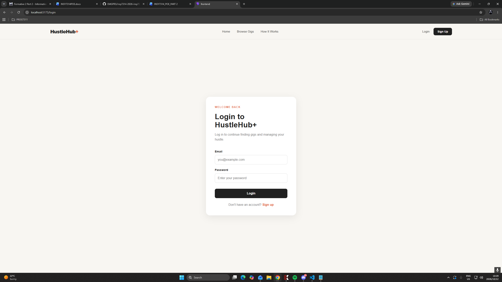

#### My Bookings Client

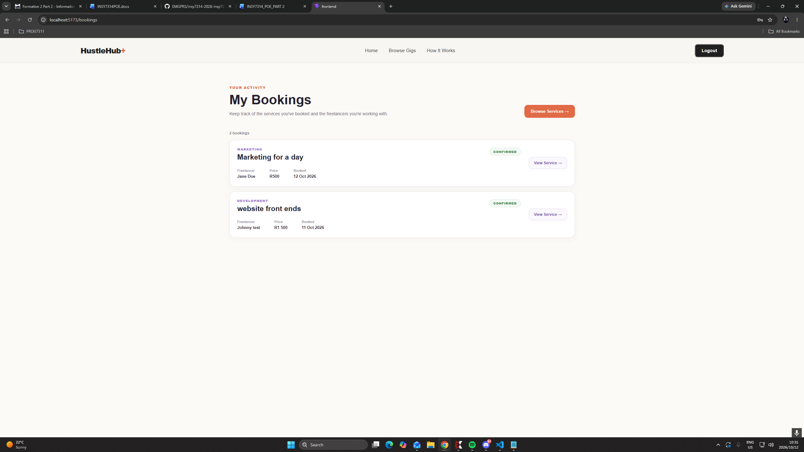

#### Payment Confirmation

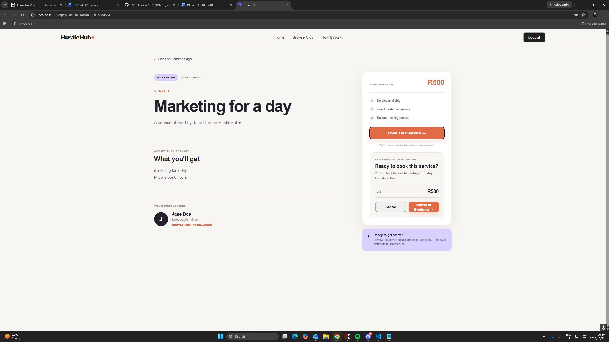

#### Register Screen

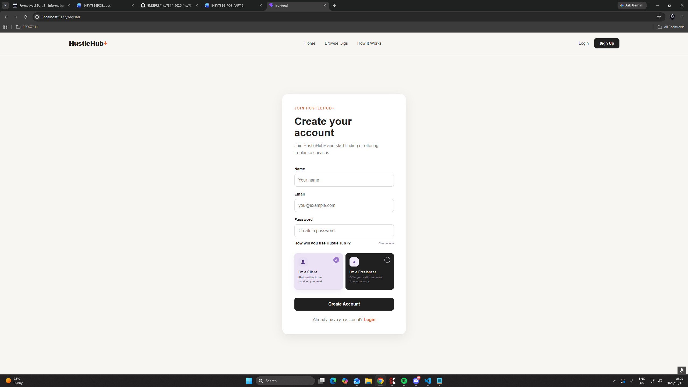

### JWT

#### JWT - No Token


#### JWT - Valid Token


#### JWT - Invalid Token


### HTTPS

#### HTTPS - Health Check


### Error Handling

#### Invalid JSON


#### Missing Content


#### Protected Route - Invalid Token


# Seperation of Work

| Name | Responsibilities |
|---|---|
| Tameez Lambaat | Endpoint setup, Password encryption, Error handling |
| Atlegang Gamede | JWT token setup, Error debugging |
| Cuan Oock | Documentation and Diagrams |
| Titus Ndaba | User Input Validation, SSL certification |

# References

The IIE, 2025. Information Systems 3D, INSY7314 MODULE MANUAL, The Independent Institute of Education: Unpublished.

GeeksforGeeks (2024). NPM bcrypt. [online] GeeksforGeeks. Available at: [https://www.geeksforgeeks.org/node-js/npm-bcrypt/](https://www.geeksforgeeks.org/node-js/npm-bcrypt/) [Accessed 5 Sept. 2026].

GeeksforGeeks (2019). JSON Web Token (JWT). [online] GeeksforGeeks. Available at: [https://www.geeksforgeeks.org/web-tech/json-web-token-jwt/](https://www.geeksforgeeks.org/web-tech/json-web-token-jwt/) [Accessed 5 Sept. 2026].

Ciampa, M. Security+ Guide to Network Security Fundamentals. 2022. 7th ed. Cengage: Boston.

Serpanos, D. & Wolf, T. Architecture of Network Systems. 2011. Burlington: Elsevier.

White, C.M. & West, J. Data Communications & Computer Networks: A Business User’s Approach. 9th Edition. 2023. Cengage Learning: Boston.