# insy7314-2026-insy7314-poe-classroom-tameezlambat

# Group Members
Cuan Oock - ST10439216 
Tameez Lambaat - ST10462078 
Atlegang GAMEDE – ST10445041 
Titus Ndaba - ST10448883 

# Project Overview
This project is the beginning of the HustleHub system. HustleHub is meant to be a system serving as a centralised location for freelancers to market themselves and provide services. The system will allow freelancers to connect with clients and manage their finances in accordance with local tax laws.  
For this part of the project a backend API server was set up that allows the account creation of a user with their relevant role in a secured, and validated manner. 
As this project handles extremely sensitive user information (e.g. user financial information, transactions, client/business information), security is of the utmost importance. Any leaking of this information could result in significant financial issues for users and legal trouble for HustleHub. This is why certain technology choices were made to allow for a secure backend API service. 

# Technology Choices
## Password Encryption
This part of the project focuses specifically on user account creation and login in a secure way. For this password security is extremely important. For passwords stored in a database, it is never good practice to store it in plain text, and it is industry standard to store passwords only if they've been through an algorithm that allows for one way hashing. This means that the password is hashed in such a manner that it cannot be reversed back into the original password (Ciampa, 2022). For this, bycrypt is used. This is an algorithm that allows for one way hashing and allows for a multiple iterations of the algorithm to run over the password for added layers of security (GeeksforGeeks, 2024). This allows for protection against brute force attacks as the algorithm is designed to be computationally heavy, meaning hackers will waste a lot of time and computing power trying to brute force multiple password attempts. It also protects against rainbow table attacks (whereby a hacker will have passwords in plain text with possible hashes), as bycrypt automatically adds a random salt to each password that is unique (GeeksforGeeks, 2024). This ultimately results in a secure environment for passwords wherein even if the hashed password is obtained, user data will remain uncompromised.
## JWT
This backend server also makes use of JWT tokens. This allows for better secure data transmission between various parties as it allows for easier authentication. For this system specifically once a user role is authorised, the user will be assigned a JWT token, which will be automatically attached to the header of any HTTPS requests through the application front end (GeeksforGeeks, 2019). This means that, without the server needing to store excess session data, the end user can have their role and user information stored and authenticated while interacting with the system.
## SSL certificate
Finally, this backend server is configured to work with HTTPS using an SSL certificate. This means that the connection would be encrypted between the server and a connecting client browser (Serpanos and Wolf, 2011). It works by the server having an SSL certificate with a public key. A client browser will use that key to create a unique session key, and that session key is used to encrypt all data transmitted. Meaning if this data is intercepted, a hacker would only have the encrypted scrambled data and would not be able to use it without the key (White and West, 2023). 
## Pre seeded Admin role
It is more secure if an admin role account may not be directly created by an user, but rather created on app start and details for this provided. The login details are as follows:
| Role  | Email                 | Password            |
| ----- | --------------------- | ------------------- |
| Admin | `admin@hustlehub.com` | `AdminPassword123!` |

# Diagrams
All diagrams are included in the submission document of this project

## Screenshots of postman testing

### Registration

#### Register - Valid Client
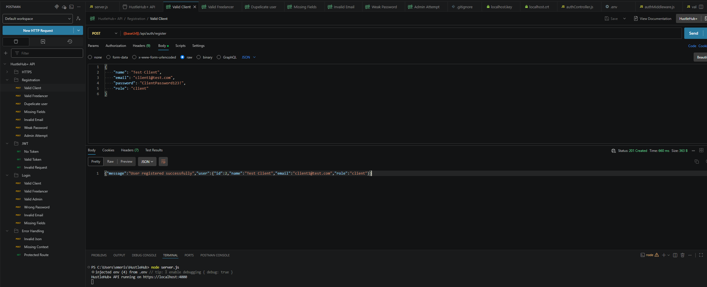

#### Register - Valid Freelancer
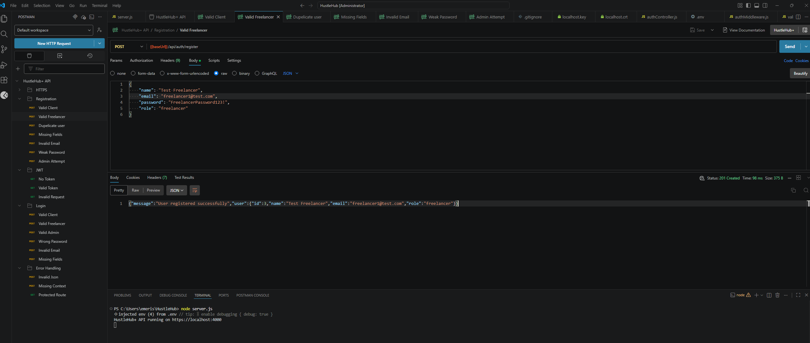

#### Register - Duplicate User
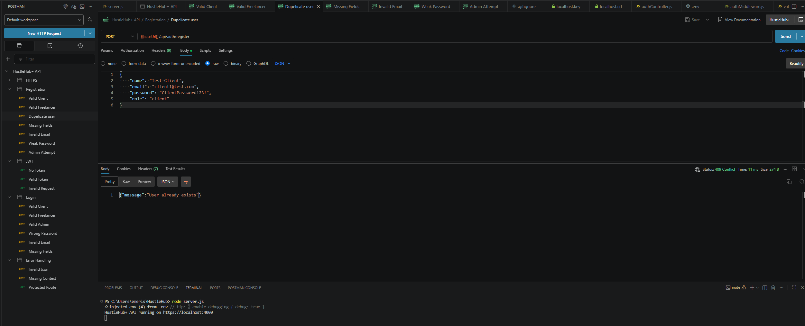

#### Register - Missing Fields
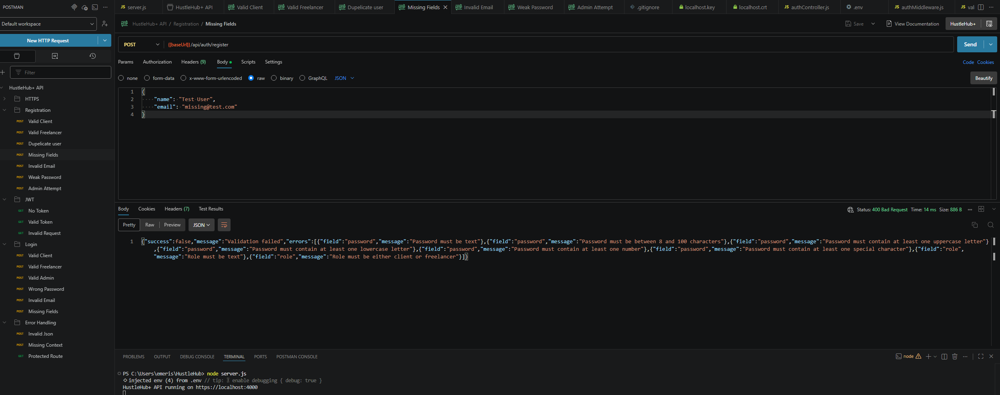

#### Register - Invalid Email
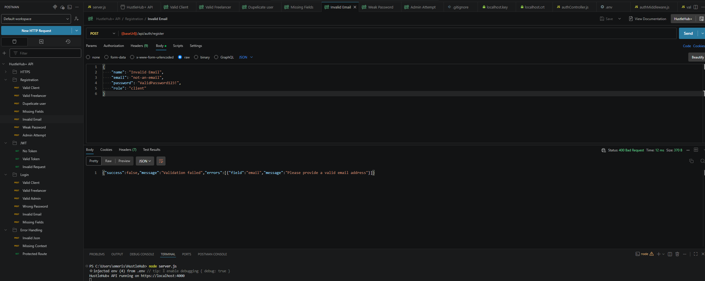

#### Register - Weak Password
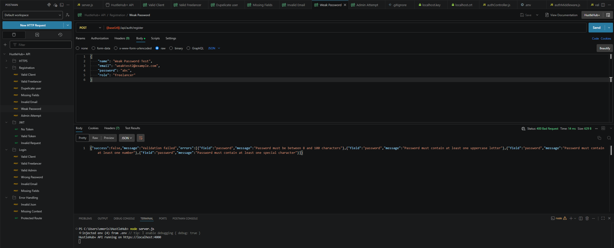

#### Register - Admin Attempt
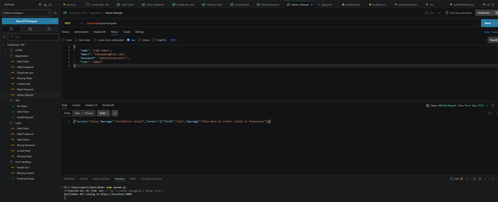

### Login

#### Login - Client - Valid
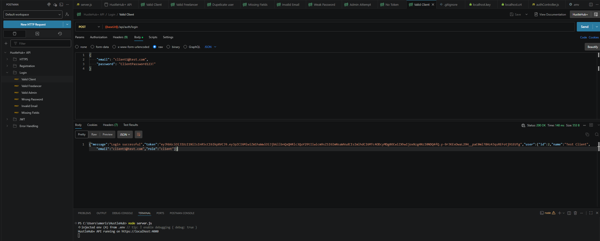

#### Login - Freelancer - Valid
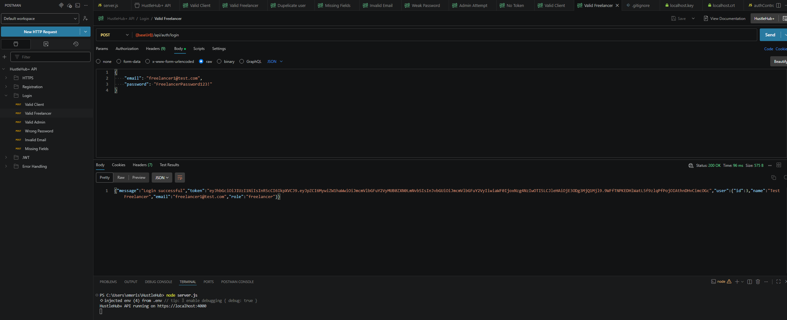

#### Login - Admin - Valid
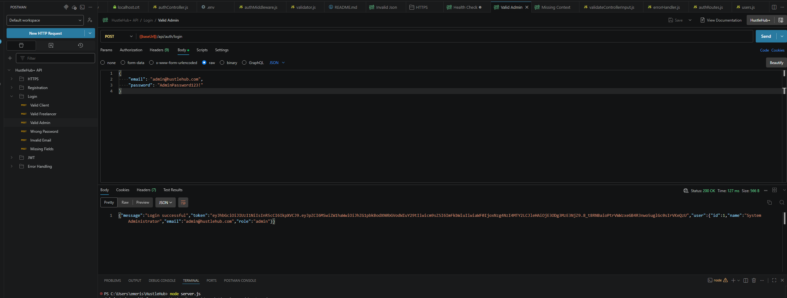

#### Login - Wrong Password
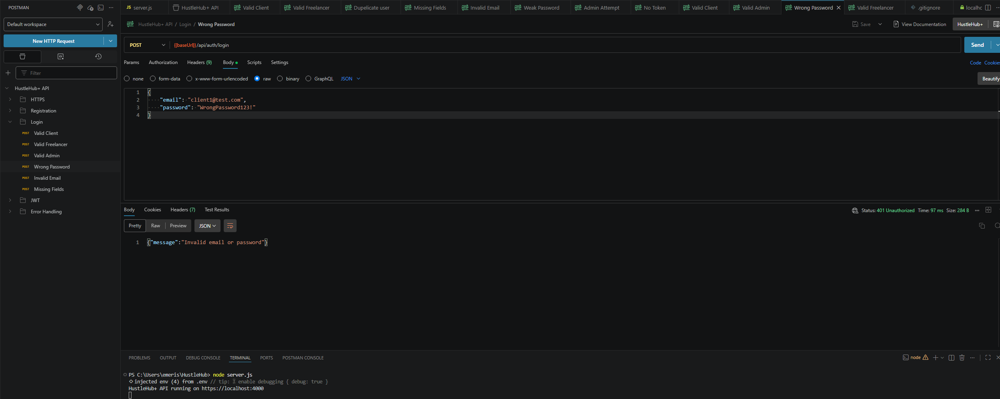

#### Login - Invalid Email
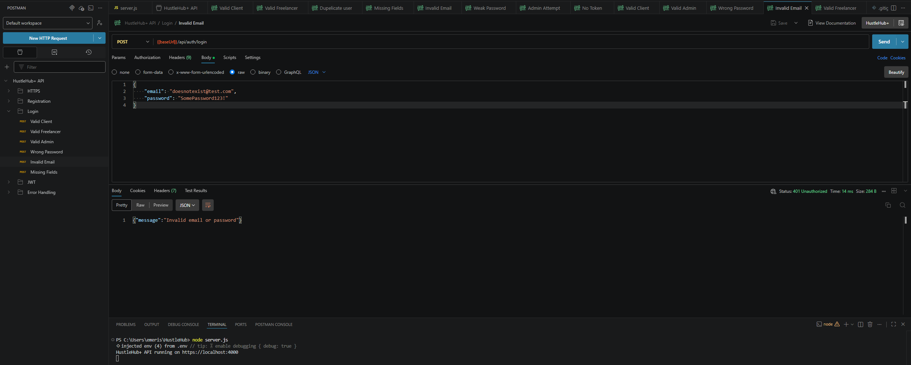

#### Login - Missing Fields
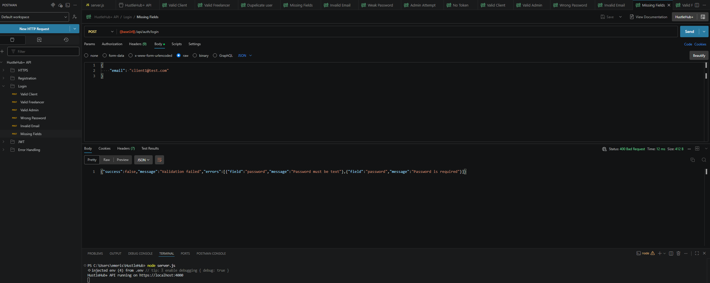

### JWT

#### JWT - No Token
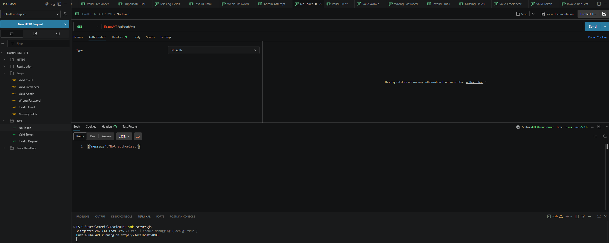

#### JWT - Valid Token
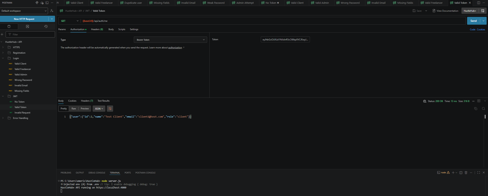

#### JWT - Invalid Token
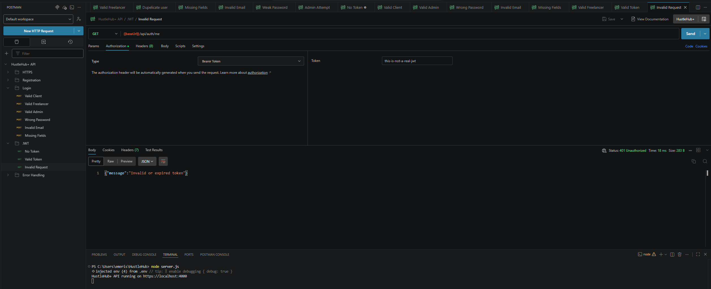

### HTTPS

#### HTTPS - Health Check
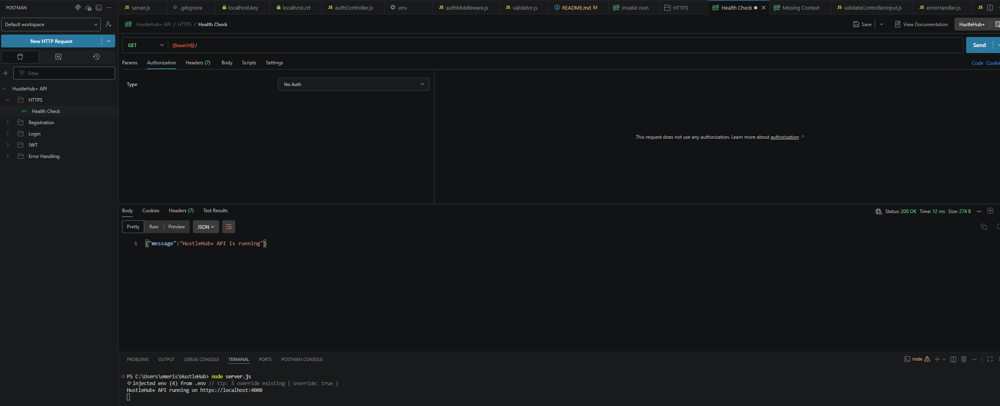

### Error Handling

#### Invalid JSON
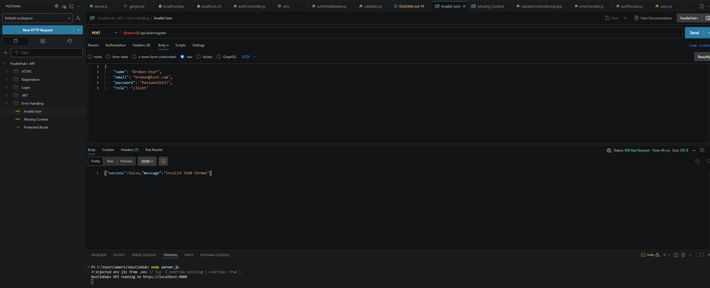

#### Missing Content
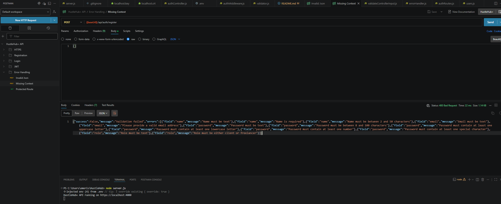

#### Protected Route - Invalid Token
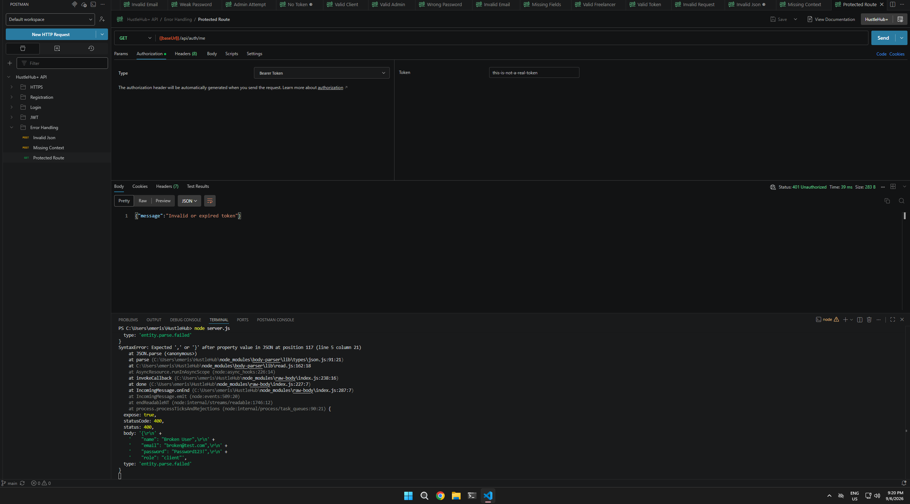

# Seperation of work

| Name             | Responsibilities                                           |
|------------------|------------------------------------------------------------|
| Tameez Lambaat   | Endpoint setup, Password encryption, Error handling        |
| Atlegang Gamede  | JWT token setup, Error debugging                           |
| Cuan Oock        | Documentation and Diagrams                                 |
| Titus Ndaba      | User Input Validation, SSL certification                   |

# References
The IIE, 2025. Information Systems 3D, INSY7314 MODULE MANUAL, The Independent Institute of Education: Unpublished 

GeeksforGeeks (2024). NPM bcrypt. [online] GeeksforGeeks. Available at: https://www.geeksforgeeks.org/node-js/npm-bcrypt/ [Accessed 5 Sept. 2026]. 

‌GeeksforGeeks (2019). JSON Web Token (JWT). [online] GeeksforGeeks. Available at: https://www.geeksforgeeks.org/web-tech/json-web-token-jwt/ [Accessed 5 Sept. 2026]. 

‌Ciampa, M. Security+ Guide to Network Security Fundamentals. 2022. 7th ed. Cengage: Boston 

Serpanos, D. & Wolf, T. Architecture of Network Systems. 2011. Burlington: Elsevier. 

White, C.M. & West, J. Data Communications & Computer Networks: A Business User’s Approach. 9th Edition. 2023. Cengage Learning: Boston 

